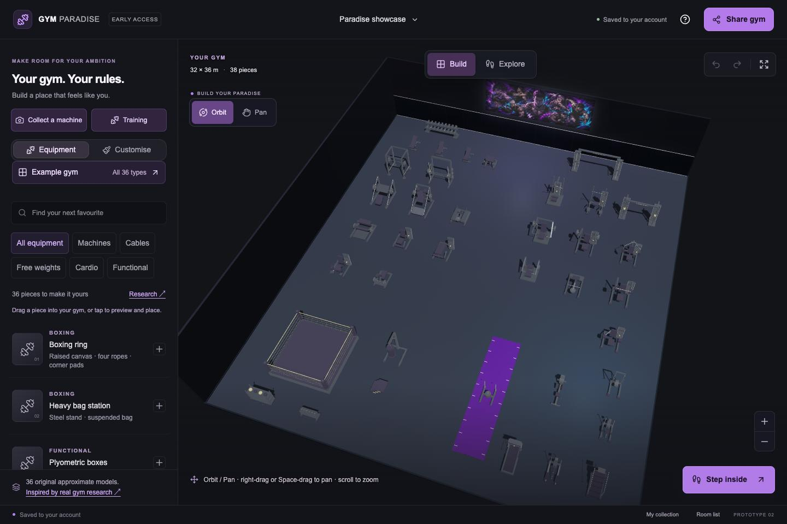
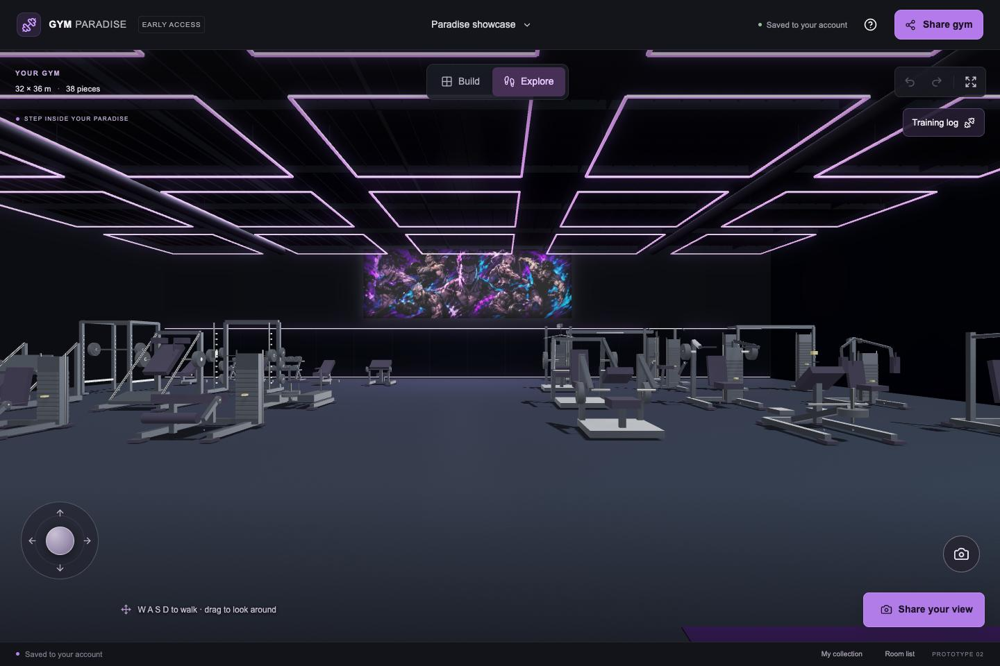
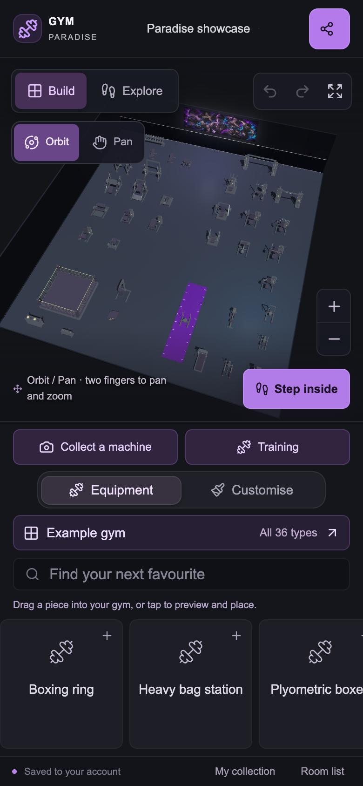

<div align="center">

# Gym Paradise

**Design your dream gym. Step inside it. Make it yours.**

A browser-based 3D gym builder for people who want to turn their dream training space into something they can explore.

[](https://github.com/PhillipVedder/gym-paradise/actions/workflows/ci.yml)


[Try locally](#try-it-locally) · [Architecture](docs/architecture.md) · [Development](docs/development.md) · [Roadmap](docs/roadmap.md)

</div>



## Why I built this

I'm a computer science graduate and a gym enthusiast. Owning a private gym is a long-term ambition; Gym Paradise lets me design and walk through that space now. The idea grew into an engineering project spanning interactive 3D graphics, touch controls, validated layout editing, private persistence, and browser-based machine recognition experiments.

The aim is a space that feels personal: choose the equipment, arrange the room, set the lighting and wall art, then step inside for a first-person tour.

## What you can do

- **Build a gym:** choose from 36 equipment types, preview placements in 3D, rotate and move pieces, and undo changes. Placement checks prevent overlaps and out-of-bounds layouts.
- **Make it yours:** edit room dimensions, wall and floor finishes, ceiling style, lighting, mirrors, murals, signs, turf, and machine colours.
- **Explore and capture:** switch to first-person navigation, take screenshots, and record a tour where the browser supports it.
- **Collect real-world inspiration:** save equipment photos, brand/model notes, and a wishlist linked to similar virtual machines. Optional OCR and image-category suggestions assist manual identification.
- **Track training:** record sets, reps, load, units, and machine settings; compare records within the same machine, exercise, and unit.
- **Save and export:** private account storage, recoverable browser drafts, conflict detection, and portable layouts that omit private photo references.

<table>
<tr>
<td width="70%"></td>
<td width="30%"></td>
</tr>
<tr><td>First-person exploration</td><td>Phone-sized layout</td></tr>
</table>

Screenshots show the actual local application and its built-in showcase. The phone image is a Chromium touch emulation, not evidence of physical iPhone testing.

## Try it locally

Use **Node.js 22.13+ within the 22.x release line** and npm. No paid API key, cloud account, or database installation is needed. Internet access is needed to install dependencies; optional recognition tools download models when requested.

```bash
git clone https://github.com/PhillipVedder/gym-paradise.git
cd gym-paradise
npm ci
npm run demo
```

Open **http://127.0.0.1:3000**. Choose **Example gym → Load example gym** to explore all 36 catalogue types in a 38-piece warehouse layout. Try dragging a machine from the library, change the lighting in Customise, then switch to Explore.

The command builds the app, applies migrations to local emulated storage, and starts a local demo account. Saves stay in `.wrangler/demo`. Stop with Ctrl+C. See [development instructions](docs/development.md) for controls, troubleshooting, and the hosted authentication boundary.

**Status:** working prototype under active development. The hosted deployment is private; the local demo is the review path for this public source repository.

## Engineering highlights

| Challenge                           | Implementation                                                                                             | Evidence                                                                         |
| ----------------------------------- | ---------------------------------------------------------------------------------------------------------- | -------------------------------------------------------------------------------- |
| Predictable 3D editing              | Shared layout validation, preview placement, room bounds, overlap checks, and undo/redo                    | [Layout logic](lib/gym-data.ts), [tests](tests/gym-data.test.mjs)                |
| Comfortable navigation              | Separate orbit/pan tools, cursor-centred zoom, touch gestures, and bounded render resolution               | [Camera maths](lib/gym-camera.ts), [tests](tests/gym-camera.test.mjs)            |
| Safe saves across devices           | Revision-based conditional writes reject stale updates instead of overwriting them                         | [State API](app/api/state/route.ts), [integration checks](tests/api-smoke.mjs)   |
| Private photos and portable layouts | Owner-scoped media access; shared exports remove private references                                        | [Storage boundary](lib/server-store.ts), [record validation](lib/gym-records.ts) |
| Responsive optional recognition     | Lazy-loaded OCR and image-category inference; image inference runs in a worker and needs user confirmation | [Matching](lib/machine-match.ts), [worker](workers/machine-vision.ts)            |
| Maintainable room graphics          | Geometry lifecycle tests check disposal, finite bounds, and mirror planes without needing a GPU            | [Room tests](tests/gym-room.test.mjs)                                            |

**Stack:** TypeScript · React 19 · Babylon.js · Tailwind CSS · Vinext / Vite · Cloudflare Workers, D1 and R2 · Drizzle schema/migrations · Node test runner · Oxlint / Oxfmt.

[Architecture and trade-offs →](docs/architecture.md)

## Verify the project

```bash
npm run check      # formatting, strict types, lint, unit/geometry tests
npm run build      # browser bundles and production Worker
npm run test:api   # isolated local D1/R2 integration tests; cleans up afterwards
```

GitHub Actions runs the same commands on pushes and pull requests. There are no cloud credentials in CI. [Testing scope and limitations →](docs/testing.md)

## What's next

Physical iPhone Safari testing, accessible alternatives to more canvas interactions, and a verified equipment catalogue are the next priorities. Exact manufacturer meshes, automatic exact-machine identification, public visitor links, and arbitrary floor plans are **not implemented**. Equipment geometry is an original visual approximation, not a purchasing or architectural specification. See the [prioritised roadmap](docs/roadmap.md).

## Project notes

- [User guide](docs/user-guide.md) — controls and current feature boundaries.
- [Equipment research](docs/equipment-research.md) — primary-source examples from 23 gym chains and destinations.
- [Asset provenance](docs/assets.md) — procedural equipment, generated mural, and attributed reflections.
- [Contributing](CONTRIBUTING.md) · [Security](SECURITY.md) · [Third-party notices](THIRD_PARTY_NOTICES.md).

Built by **[Phillip Vedder](https://github.com/PhillipVedder)** through iterative, AI-assisted development. This repository records the implementation, design decisions, tests, and remaining limitations.

Original project code is published for review with **all rights reserved**; it is not MIT-licensed. Third-party components and assets retain their own licences. See [LICENSE](LICENSE).
