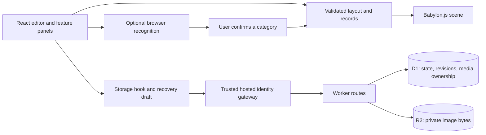

# Architecture

Gym Paradise keeps the editable gym as serialisable data. React manages the interface and editing history; Babylon.js renders that data into an interactive scene. The server validates and persists the same representation.

For local review, a loopback-only demo proxy replaces the identity gateway with one fixed local account. It is a separate Node script and is not part of the production Worker.

## Module boundaries

| Area                                     | Responsibility                                                      |
| ---------------------------------------- | ------------------------------------------------------------------- |
| `app/gym-app.tsx`                        | Editing state, undo/redo, catalogue, input orchestration, tours     |
| `components/gym-*.tsx`                   | Customisation, example layout, collection and training panels       |
| `lib/gym-data.ts`, `gym-design.ts`       | Layout types, catalogue, dimensions, validation, shared invariants  |
| `lib/gym-camera.ts`                      | Testable camera/pan/zoom and render-scale calculations              |
| `lib/gym-scene.ts`                       | Babylon scene lifecycle, picking, interaction, capture              |
| `lib/gym-room.ts`, `equipment-models.ts` | Room structures, materials, original procedural equipment           |
| `lib/gym-records.ts`                     | Collection/training validation, imports, privacy-preserving exports |
| `hooks/use-gym-storage.ts`               | Load/save lifecycle, recoverable drafts, conflict state             |
| `app/api/`, `lib/server-store.ts`        | Trusted identity, request limits, ownership, persistence            |
| `db/`, `drizzle/`                        | Database schema and versioned migrations                            |
| `workers/machine-vision.ts`              | Optional image-category inference away from the UI thread           |
| `scripts/`                               | Local review and isolated API-test tooling                          |

The remaining `components/ui` files are the three shared shadcn/Base UI primitives actually used by the app. Unused starter components were removed rather than excluded from lint.

## Save lifecycle and concurrency

1. A request with a trusted hosted identity loads the account state and its revision.
2. User edits update validated client state and an account-scoped browser recovery draft.
3. After a debounce, the client sends the complete state with its last known revision.
4. D1 updates the row only if the revision still matches. A stale write receives HTTP 409.
5. Successful saves advance the revision. Conflicting clients can preserve a backup before loading the current cloud state.

This is optimistic concurrency, not real-time collaboration. A second open device does not continuously receive remote updates. Whole-document saves keep the prototype simple; a larger product may need smaller updates and explicit merge rules.

## Storage and trust boundary

`gym_states` stores the validated state as JSON with an owner ID and revision. Media bytes live in R2; D1 records ownership. State writes verify that any referenced media belongs to the same owner. Private responses bypass shared caches.

The production routes trust the `oai-authenticated-user-id` header supplied by the Sites authentication gateway. **The Worker must not be exposed directly to untrusted clients that can choose that header.** Moving to another host requires verified authentication at the server boundary and removal or rejection of client-supplied identity headers. There is no production anonymous fallback.

The demo proxy binds to `127.0.0.1`, checks Host/Origin and browser cross-site metadata, strips browser credentials, and sets a fixed `local-demo` identity. Its upstream Worker also binds to loopback. It is developer tooling, not a deployable authentication solution. Other processes on the same machine are outside this isolation boundary.

## Deliberate trade-offs

- **Browser first:** one implementation covers laptop and phone interfaces. Physical iPhone performance still needs measurement; emulation is insufficient.
- **Procedural equipment:** a broad catalogue without depending on unavailable commercial meshes. Shapes remain approximate; an exact brand name in a wishlist does not make the displayed model exact.
- **Babylon.js:** scene graph, materials, picking, cameras and recording support provide a practical base. Pure calculations stay outside the rendering layer so they can be tested independently.
- **Bounded scenes:** at most 40 placed pieces, capped pixel resolution, and selective shadows/reflections limit work. A room may be up to 500 m across without implying support for hundreds of machines.
- **Optional local inference:** no paid inference API is required. OCR and image models cost download time and memory, so manual selection stays available. No claim of exact SKU recognition is made.
- **One rectangular room:** keeps placement and collision rules understandable. Arbitrary walls and multi-storey spaces need a different floor-plan model.
- **Hosted runtime:** Vinext and Sites support the current deployment, but are an infrastructure dependency. The local production Worker allows review without an account; migrating hosting remains a separate task.

## Further reading

[Development](development.md) · [Testing](testing.md) · [Roadmap](roadmap.md) · [Asset provenance](assets.md)
